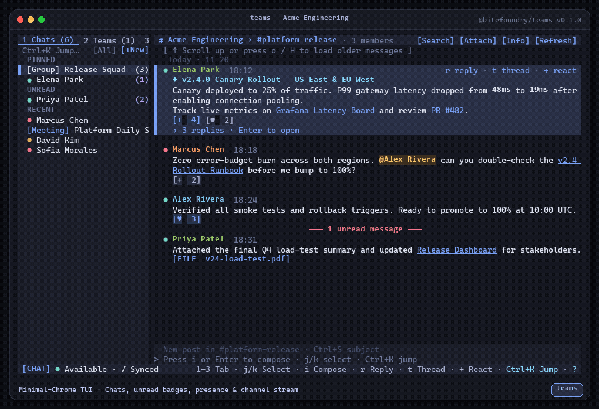

<div align="center">

# `teams`

**Blazing-fast Microsoft Teams terminal client & AI agent toolkit — CLI, TUI, HTTP API, and MCP in one native Rust binary.**

[](https://www.npmjs.com/package/@bitefoundry/teams)
[](docs/NPM.md)
[](https://ratatui.rs)
[](https://opensource.org/license/mit)

<br />



</div>

---

## Highlights

| Pillar | What You Get |
| --- | --- |
| **Minimal-Chrome TUI** | 3-tier responsive `ratatui` layout (`Wide` / `Medium` / `Narrow`), Composer-First workflow, side-by-side Thread Drawer, Link Extractor (`u`), `zoxide` File Picker (`Ctrl+F`), Unified `Ctrl+K` Omni-Switcher, Cozy/Compact density (`Ctrl+D`), and multi-depth themes (`Midnight Dark`, `Daylight Light`, `ANSI 256/16`, `NO_COLOR`). |
| **High-Res Terminal Images** | Native inline rendering for attachments & pasted `hostedContents` screenshots across **Kitty**, **iTerm2 (`OSC 1337`)**, **Sixel (`DCS q`)**, and **24-bit Half-Blocks (`▀`)** universal fallback with live zoom (`+`/`-`/`0`) and protocol switching (`p`). |
| **Local SQLite FTS5 + IPC Daemon** | Bundled SQLite WAL + FTS5 cache (`cache.db`) with `@odata.nextLink` deep history cursors, instant offline hybrid search (`teams search`), and sub-5ms cached CLI reads via `teams daemon`. |
| **4-in-1 Agent Interface** | One static binary (Windows, macOS, Linux **GLIBC 2.28 / AlmaLinux 8+**) delivers **TUI**, scriptable **CLI (`--json`)**, **Axum HTTP REST API (`teams serve`)**, and **stdio MCP server (`teams mcp`, 18 tools)**. |

---

## Quick Start

```bash
# 1. Install globally via npm (links prebuilt native binary, zero Node runtime overhead)
npm i -g @bitefoundry/teams

# 2. Sign in with the desktop application registered by your organization
teams login --client-id YOUR_CLIENT_ID --tenant-id YOUR_TENANT_ID

# 3. Launch the interactive TUI
teams
```

IT administrators can register the app, select delegated permissions and verify a sign-in in Entra. For the public Microsoft Graph Command Line Tools client, run `teams login`. [Company app registration guide](docs/ENTERPRISE.md)

> **Alternative installs:** Run one-off with `npx @bitefoundry/teams`, download prebuilt binaries from [GitHub Releases](https://github.com/BiteFoundry/teams/releases), or build from source with `cargo build --release` (Rust 1.80+, zero external OpenSSL/SQLite deps). Self-update anytime with `teams update`.
>
> **External Token Brokers & Custom Entra ID Apps:** Supports `TEAMS_ACCESS_TOKEN`, `TEAMS_TOKEN_FILE`, `TEAMS_TOKEN_REFRESH_CMD` (including `az account get-access-token`), and custom `--client-id` / `--tenant-id`. Run `teams whoami` or `teams doctor --probe` for instant JWT scope diagnostics.

---

## Keybindings Cheat Sheet

| Key | Context | Action |
| --- | --- | --- |
| `Ctrl+K` | Global | **Omni-Switcher / Command Palette** (`>` commands, `#` channels, `@` chats, `/` search) |
| `1` / `2` / `3` (`Alt+1..3`) | Global | Switch **Chats** / **Teams** / **Activity** (`@mentions`) tabs |
| `j` / `k` / `↑` / `↓` | Nav / Chat | Navigate conversations, messages, or thread replies |
| `i` / `Enter` | Chat / Composer | Focus Composer (`Enter` sends, `Shift+Enter` newline, `Ctrl+V` pastes clipboard image) |
| `t` / `Alt+T` | Chat / Thread | Open right-side **Thread Drawer** / toggle Composer target (`Thread` vs `Channel`) |
| `r` / `+` / `y` / `Del` | Chat / Thread | Quote-reply / add reaction / copy message / delete own message |
| `u` / `h` | Chat / Thread | Open **Link Extractor** overlay (`Enter` open, `y` copy) / toggle inline `href` URLs |
| `v` / `Alt+v` | Chat / Composer | Open high-res **Inline Image Preview** (`+`/`-`/`0` zoom, `p` protocol, `d` save) |
| `Ctrl+F` / `Ctrl+O` | Global | Open built-in **File Picker** (with `z` `zoxide` quick-jump) / send file by path |
| `o` / `H` | Chat | Load older message page (`o`) / deep history backfill (`H`) |
| `/` / `Ctrl+N` / `Ctrl+P` | Global | Search local FTS5 cache / new chat / update Presence status |
| `Ctrl+D` / `Ctrl+B` | Global | Toggle **Cozy / Compact** density / toggle left sidebar |
| `Ctrl+,` / `?` / `Ctrl+Q` | Global | **Settings** / full help overlay / safe quit |

---

## CLI, HTTP API & MCP

### CLI Examples

```bash
# List chats, read history, and send Markdown with @mentions or attachments
teams chats --limit 50 --json
teams read "Acme Engineering/platform-release" --limit 30
teams send "Acme Engineering/platform-release" "**v2.4.0** canary is green!" --subject "Release Update"
teams reply "Acme Engineering/platform-release" 1700000000000 "Confirmed zero 5xx spikes."
teams send-file "Elena Park" ./latency-p99.png --inline --caption "P99 latency benchmark"

# Read a cached thread and edit a post you sent
teams thread "Acme Engineering/platform-release" 1700000000000 --offline --limit 2 --json --compact
teams edit "Acme Engineering/platform-release" 1700000000000 --find "STATE: STAGED" --replace "STATE: READY"
teams edit "Acme Engineering/platform-release" 1700000000000 --subject "Canary rollout"
teams update-chat "Release handoff" --topic "Canary war room"

# Offline FTS5 search, deep history sync, presence, and background daemon
teams search "connection pooling" --json
teams sync --chats 100 --depth 100
teams presence --set DoNotDisturb --expiration-mins 60
teams daemon start
```

`teams edit TARGET MSG_ID MARKDOWN` replaces the entire body. `--find` and `--replace` edit one exact occurrence in a single text node of the latest body, preserving links, mentions, images, and attachment references. A missing, repeated, or cross-tag match fails before the write. Channel edits require a signed-in author's delegated token with `ChannelMessage.ReadWrite` (or legacy `Group.ReadWrite.All`). Chat edits use `Chat.ReadWrite`. Graph returns an error when permissions or Teams policy deny the edit. [Microsoft Graph message update](https://learn.microsoft.com/en-us/graph/api/chatmessage-update?view=graph-rest-1.0)

`teams edit --subject` changes the plain-text title of a channel root post you sent. Use the subject option by itself for a PATCH containing only `subject`. `teams update-chat --topic` changes an existing group chat's title using delegated `Chat.ReadWrite`. Topics allow up to 250 characters and exclude colons. [Microsoft Graph chat update](https://learn.microsoft.com/en-us/graph/api/chat-patch?view=graph-rest-1.0)

`read` and `thread` accept `--json --compact` to return IDs, authors, timestamps, plain text, reply links, and attachment IDs and names. In a thread, `--limit` caps the replies and the response includes the root separately. Use `--offline` after an online thread read that covered the requested replies.

### Local HTTP REST API (`teams serve`)

Start an Axum JSON server on `127.0.0.1:8788` (add `--token <secret>` for Bearer auth):

```bash
teams serve --port 8788
curl http://127.0.0.1:8788/conversations
curl -X POST http://127.0.0.1:8788/conversations/Elena%20Park/messages \
  -H "Content-Type: application/json" \
  -d '{"markdown":"Build is green — ready to ship!"}'
```

Full endpoint & schema docs: **[docs/API.md](docs/API.md)** · **[docs/openapi.yaml](docs/openapi.yaml)**

### MCP Server (`teams mcp`)

Exposes **18 Microsoft Teams tools** (`list_chats`, `create_chat`, `update_chat`, `list_teams_channels`, `get_messages`, `get_thread`, `send_message`, `reply_message`, `send_file`, `download_attachment`, `react_message`, `edit_message`, `delete_message`, `search_messages`, `list_members`, `mark_read`, `get_presence`, `set_presence`) over newline-delimited stdio JSON-RPC 2.0:

```bash
# Claude Code
claude mcp add teams -- teams mcp
```

```json
// Claude Desktop / Cursor / Windsurf MCP config
{
  "mcpServers": {
    "teams": {
      "command": "teams",
      "args": ["mcp"]
    }
  }
}
```

Full tool schemas & client setups: **[docs/MCP.md](docs/MCP.md)** · **[docs/NPM.md](docs/NPM.md)**

---

## `@bitefoundry` Enterprise Terminal Suite

| Package | Command | Domain | Interfaces |
| --- | --- | --- | --- |
| **`@bitefoundry/teams`** *(this repo)* | `teams` | Microsoft Teams (Chats, Channels, Threads, Presence) | TUI · CLI · HTTP · MCP |
| [`@bitefoundry/outlook`](https://github.com/BiteFoundry/outlook) | `outlook` | Microsoft Outlook (Mail, Calendar, To Do, Contacts) | TUI · CLI · HTTP · MCP |
| [`@bitefoundry/onenote`](https://github.com/BiteFoundry/onenote) | `onenote` | Microsoft OneNote (Notebooks, Sections, Pages) | TUI · CLI · HTTP · MCP |
| [`@bitefoundry/sharepoint`](https://github.com/BiteFoundry/sharepoint) | `sharepoint`, `bitefoundry-onedrive` | SharePoint & OneDrive (Sites, Drives, Lists, Files) | TUI · CLI · HTTP · MCP |
| [`@bitefoundry/atlassian`](https://github.com/BiteFoundry/atlassian) | `atlassian`, `confluence`, `conf` | Jira & Confluence (Issues, Boards, Sprints, Wiki) | TUI · CLI · HTTP · MCP |
| [`@bitefoundry/notion`](https://github.com/BiteFoundry/notion) | `notion` | Notion (Pages, Databases, Blocks, Comments) | TUI · CLI · HTTP · MCP |

---

## License & Disclaimer

Licensed under the [MIT License](https://opensource.org/license/mit).

Unofficial terminal client for Microsoft Teams. Not affiliated with, endorsed by, or sponsored by Microsoft Corporation.
